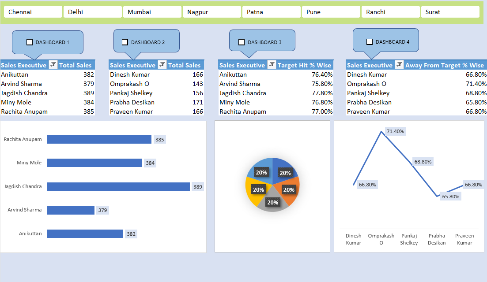

# 📊 Sales Performance Dashboard – Excel

An interactive **Excel Sales Dashboard** designed to analyze sales performance, employee sales achievements, target hit percentages, and sales distribution across multiple cities.

## 📈 Dashboard Preview

## 📌 Project Overview

This project analyzes sales executive performance across multiple cities using an interactive Excel dashboard. It provides insights into sales achievements, target hit percentages, and performance comparisons across sales representatives.

## 🚀 Dashboard Features

- City-wise Sales Analysis
- Sales Executive Performance Comparison
- Total Sales Analysis
- Target Hit Percentage Analysis
- Sales Performance Ranking
- Sales Distribution Visualization
- Target Achievement Comparison
- Interactive Dashboard Navigation

## 📊 Dashboard Components

### Dashboard 1 – Sales Performance
- Sales Executive-wise Total Sales
- Horizontal Bar Chart for Sales Comparison

### Dashboard 2 – Sales Distribution
- Sales Contribution Visualization
- Executive-wise Sales Distribution

### Dashboard 3 – Target Achievement
- Sales Executive-wise Target Hit Percentage
- Target Performance Comparison

### Dashboard 4 – Target Variance
- Away From Target Percentage
- Executive-wise Target Performance Trend

## 🛠 Tools & Technologies

- Microsoft Excel
- Pivot Tables
- Pivot Charts
- Slicers
- Excel VBA / Macros
- Data Visualization
- Sales Analytics

## 💡 Skills Demonstrated

- Data Analysis
- Sales Performance Analysis
- Excel Dashboard Development
- KPI Reporting
- Interactive Dashboard Design
- Business Intelligence
- Data Visualization

## 🎯 Business Use Cases

- Sales Performance Monitoring
- Sales Executive Evaluation
- Target Achievement Tracking
- Regional Sales Comparison
- Business Reporting
- Sales Strategy Improvement

## 📂 Project Files

| File | Description |
|---|---|
| `Sales_Dashboard.xlsm` | Macro-Enabled Excel Dashboard |
| `sales_dashboard.png` | Dashboard Screenshot |
| `README.md` | Project Documentation |

## ▶️ How to Use

1. Download the repository.
2. Open `Sales_Dashboard.xlsm` using Microsoft Excel.
3. Enable macros if prompted.
4. Navigate through Dashboard 1, Dashboard 2, Dashboard 3, and Dashboard 4.
5. Use the city filters to explore sales performance.
6. Analyze executive sales and target achievement.
